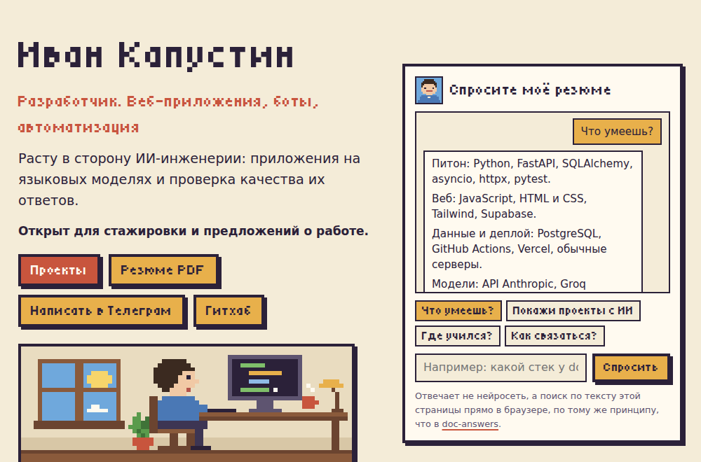

# maarshir.github.io

Показывает резюме и проекты в пиксельном стиле: [maarshir.github.io](https://maarshir.github.io).

[](https://github.com/maarshir/maarshir.github.io/actions/workflows/tests.yml)

[](https://maarshir.github.io)

На первом экране пиксельный персонаж печатает за компьютером, а за окном утро, день, вечер или ночь по часам гостя. Рядом окно «Спросите моё резюме»: можно нажать готовый вопрос или написать свой. Отвечает не нейросеть, а поиск по данным сайта прямо в браузере, как в [doc-answers](https://github.com/maarshir/doc-answers), и под ответом видно, где он нашёлся. Ниже карточки проектов в виде картриджей.

Для любопытных внизу есть пасхалка: пиксельный городок, где проекты стоят домами и по ним можно погулять персонажем ([прямая ссылка](https://maarshir.github.io/#town)).

## Как запустить у себя

```bash
git clone https://github.com/maarshir/maarshir.github.io
cd maarshir.github.io
npm test     # проверки данных, сборки, доступности и веса страницы
npm start    # сайт на http://localhost:8000 (нужен python3)
```

Нужен Node.js 20 или новее, для самой страницы и тестов зависимостей нет. Все тексты лежат в `data/profile.json` и `data/projects.json`, тексты резюме PDF в `data/resume.json`. После правки данных:

```bash
npm run build                               # index.html, favicon.svg, resume.html и превью из data/*.json
npm ci                                      # один раз: playwright-core для PDF и картинки превью
npx playwright-core install chromium        # один раз: Chromium
npm run assets                              # resume.pdf и assets/og.png
```

На Гитхабе те же команды выполняет `build.yml` после каждого пуша с изменёнными данными или кодом сборки, поэтому данные можно править прямо в браузере. Снимок экрана для этого README обновляет `screenshot.yml`.

## Как устроено

```text
data/*.json -> npm run build -> index.html, resume.html, assets/og-card.html
                                resume.html, og-card.html -> npm run assets (Chromium) -> resume.pdf, assets/og.png
в браузере:  index.html + js/ask.mjs   поиск по разделам data/*.json для «Спросите моё резюме»
             /#town -> js/town/        городок на canvas из того же data/projects.json
```

- **Обычный HTML, CSS и JavaScript без фреймворков.** Страница вместе со шрифтом, CSS и JS весит около 170 килобайт и открывается сразу.
- **Страница собирается заранее.** HTML готов ещё до открытия, поэтому сайт виден без JavaScript, его читают поисковики и превью ссылок в мессенджерах.
- **Один источник правды.** Главная, картинка превью и окна в городке берутся из тех же двух файлов данных и не могут разойтись. Резюме PDF берёт оттуда имя и контакты, а свои тексты из `data/resume.json`.

<details>
<summary>Файлы проекта</summary>

```text
data/profile.json    кто я, обо мне, образование, работа, стек, контакты
data/resume.json     тексты резюме PDF: заголовок, проекты, опыт, стек, образование
data/projects.json   проекты: раздел (main или personal), строка для карточки, описание, стек, код и здание в городке (null, если кода или здания нет)
js/render.mjs        проверка данных и сборка HTML главной страницы
js/avatar.mjs        пиксельный аватар 16×16 строками букв и перевод его в SVG
js/ask.mjs           «Спросите моё резюме»: основы слов, BM25 по разделам, сборка ответа из данных
js/chat.mjs          окно чата в браузере: кнопки, поле, печать ответа
js/typewriter.mjs    печатная машинка, общая для чата и окон городка
js/scene.mjs         пиксельная сцена первого экрана в SVG и время суток по часу гостя
js/walker.mjs        персонаж у края: место от доли прокрутки, направление, кадр шага
js/live.mjs          связка сцены, появления карточек и персонажа у края с браузером
js/town/map.mjs      карта городка: тайлы, здания, двери, точка появления
js/town/physics.mjs  движение и столкновения у ног персонажа
js/town/path.mjs     поиск пути по клику (A*) и ближайший свободный тайл
js/town/camera.mjs   целый масштаб пикселей и мягкая камера
js/town/mode.mjs     что показать: главную или городок (только по /#town)
js/town/sprites.mjs  персонаж в четырёх направлениях, дерево, знаки зданий
js/town/draw.mjs     рисование карты и персонажа на canvas
js/town/interact.mjs какое здание рядом, текст подсказки и окна из данных
js/town/main.mjs     связка с браузером: цикл кадров, клавиатура, клик, подсказка и окно здания
js/resume.mjs        резюме на одну страницу A4, картинка превью и теги превью в <head>
scripts/build.mjs    вставляет собранный HTML и теги <head> в index.html, собирает favicon.svg, resume.html и assets/og-card.html
scripts/render-assets.mjs  resume.html в resume.pdf и og-card.html в og.png через Chromium, хэши исходников в assets/stamp.json
scripts/screenshot.mjs  снимок первого экрана для README в docs/screen.png
css/site.css         палитра, пиксельные рамки, светлая и тёмная тема, печать
css/town.css         городок на весь экран, кнопка в него внизу главной
fonts/               пиксельный шрифт Tiny5, встроенный в CSS, и его лицензия
assets/              фото, шрифт Golos Text с лицензией и QR-код для резюме, картинка превью
test/                тесты на встроенном node --test
```

</details>

## Что было непросто

- **Городок был входом, а стал пасхалкой.** Сначала сайт открывался игрой, но гость не станет гулять по карте, чтобы найти проекты. Теперь первой открывается обычная страница, а городок ждёт внизу.
- **Пиксельный шрифт с нормальной кириллицей.** В первом шрифте «К» читалась как «Ќ». Из трёх свободных шрифтов подошёл Tiny5, и он только в заголовках.
- **Поиск по резюме без сервера и модели.** Ответ ищется в браузере: слова сводятся к основам, разделы данных ранжируются по BM25, ответ собирается только из найденного раздела, и под ним видно, откуда он. Ключи и сервер не нужны. Сложнее всего было с вопросами другими словами: «Где учился?» должен находить «Образование», хотя слова «учился» там нет. Помогли подсказки к разделам и синонимы, а тесты проверяют десяток с лишним обычных вопросов.
- **Резюме PDF из тех же данных.** `resume.html` переводится в PDF через Chromium из Playwright, поэтому вёрстка резюме обычные HTML и CSS со своим шрифтом. Пересобрать PDF байт в байт нельзя (дата внутри, шрифты у версий Chromium разные), поэтому рядом лежат хэши исходного HTML, и тест падает, если PDF забыли обновить.
- **Контраст и фокус.** В светлой теме красный текст и жёлтая рамка фокуса не дотягивали до WCAG 2.1 AA, их пришлось затемнить, а в городке на зелёном фоне рамка осталась светлой. Тест считает контраст цветов прямо из CSS в обеих темах, проверяет видимую рамку фокуса с клавиатуры, порядок Tab и подписи кнопок и полей.
- **Телефон и вес страницы.** Длинные ссылки ломали ширину на телефоне. Теперь тест ищет в CSS ширины больше 360px вне медиазапросов, проверяет переносы, размеры картинок, ленивую загрузку и скрипты без задержки отрисовки, а вес `index.html` с CSS и JS держит под порогом, чтобы страница не разрасталась незаметно.
- **Ходить по городку и не застревать.** Сталкиваются только ноги персонажа, а движение по осям считается отдельно, поэтому он скользит вдоль стен. Тест проверяет, что до двери каждого дома можно дойти.

Подробнее: [docs/решения.md](docs/решения.md), про резюме и превью: [docs/резюме-и-превью.md](docs/резюме-и-превью.md).

## Что дальше

- Английская версия переключателем, с теми же данными и тестами.
- Чат: исправление опечаток и вопросы из двух частей.

128 тестов на встроенном `node --test`. `test/a11y.test.mjs` проверяет по собранной странице подписи кнопок и полей, порядок заголовков, рамку фокуса с клавиатуры и отключение анимаций при `prefers-reduced-motion`. `test/contrast.test.mjs` считает контраст цветов из CSS в обеих темах по порогам WCAG 2.1 AA (текст 4.5:1, крупный текст и рамка фокуса 3:1) и следит, чтобы порядок Tab шёл по странице. `test/mobile.test.mjs` отвечает за ширину 360px и вес главной.

## Лицензии

Код сайта и пиксель-арт мои. Шрифт Tiny5 © The Tiny5 Project Authors, SIL Open Font License 1.1, текст лицензии в [fonts/OFL-Tiny5.txt](fonts/OFL-Tiny5.txt). Шрифт Golos Text в резюме © The Golos Text Project Authors, SIL Open Font License 1.1, текст лицензии в [assets/OFL-GolosText.txt](assets/OFL-GolosText.txt).
